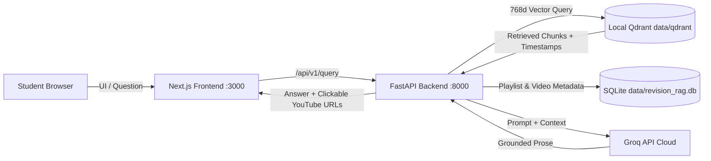

# Revision RAG

Revision RAG is an open-source, self-hosted revision knowledge base that turns YouTube playlists into searchable revision assistants with grounded answers and clickable timestamp citations.

This version features a **zero-hosting-cost, local-first distribution architecture**:
- **Pre-Indexed Knowledge Base**: Distributed with 7,000 vectors across **Strivers A2Z-DSA Course** and **Generative AI using LangChain**.
- **Embedded Local Qdrant**: Operates embedded on disk at `data/qdrant` without Docker, cloud vector accounts, or remote retrieval servers.
- **Compact Seed Database**: Seeded from `data/knowledge_base/student_revision_rag.db`.
- **Private BYO-Key LLM Generation**: Uses your own free Groq API key (`openai/gpt-oss-120b`) for ultra-fast grounded answer generation.

---

## Prerequisites

Revision RAG is strictly locked to **Python 3.12.x**. Ensure the required tools are installed:

| Software | Required Version | Verification Command | Official Download |
| :--- | :--- | :--- | :--- |
| **Git** | Recent stable version | `git --version` | [git-scm.com/downloads](https://git-scm.com/downloads) |
| **Python** | **3.12.x** (strictly locked) | `py -3.12 --version` or `python3.12 --version` | [python.org/downloads/release/python-3120/](https://www.python.org/downloads/release/python-3120/) |
| **Node.js** | 20 LTS or newer | `node --version` | [nodejs.org/en/download](https://nodejs.org/en/download) |
| **npm** | Included with Node.js | `npm --version` | [nodejs.org/en/download](https://nodejs.org/en/download) |

---

### Installing Prerequisites by Operating System

#### Windows

Using `winget` (Windows Package Manager):

```powershell
winget install --id Git.Git -e
winget install --id Python.Python.3.12 -e
winget install --id OpenJS.NodeJS.LTS -e
```

> **Important**: Close and reopen your terminal after running the installation commands so the new tools are registered in your `PATH`. When installing Python manually from python.org, ensure **"Add python.exe to PATH"** is selected.

Verify the installations:

```powershell
git --version
py -3.12 --version
node --version
npm --version
```

If `winget` is not available, download and install directly:
- **Git**: [https://git-scm.com/downloads](https://git-scm.com/downloads)
- **Python 3.12**: [https://www.python.org/downloads/release/python-3120/](https://www.python.org/downloads/release/python-3120/)
- **Node.js 20 LTS**: [https://nodejs.org/en/download](https://nodejs.org/en/download)

---

#### Ubuntu / Debian Linux

Install Git, Python 3.12 with venv/pip, and Node.js 20 LTS:

```bash
# 1. Update package lists and install Git
sudo apt update && sudo apt install -y git curl

# 2. Install Python 3.12 and venv support
# On Ubuntu 24.04+ (Noble), Python 3.12 is the default system Python:
sudo apt install -y python3.12 python3.12-venv python3-pip

# On older Ubuntu releases (e.g. 22.04 LTS), add the official deadsnakes PPA:
# sudo add-apt-repository -y ppa:deadsnakes/ppa
# sudo apt update && sudo apt install -y python3.12 python3.12-venv python3-pip

# 3. Install Node.js 20 LTS via official NodeSource repository
curl -fsSL https://deb.nodesource.com/setup_20.x | sudo -E bash -
sudo apt install -y nodejs
```

Verify the installations:

```bash
git --version
python3.12 --version
node --version
npm --version
```

If your distribution package manager does not provide Python 3.12, install it from the official source or download:
- **Python 3.12**: [https://www.python.org/downloads/release/python-3120/](https://www.python.org/downloads/release/python-3120/)
- **Node.js**: [https://nodejs.org/en/download](https://nodejs.org/en/download)

---

#### macOS

Using Homebrew:

```bash
brew install git python@3.12 node@20
```

Verify the installations:

```bash
git --version
python3.12 --version
node --version
npm --version
```

If Homebrew is not installed, use the official pkg installers:
- **Git**: [https://git-scm.com/downloads](https://git-scm.com/downloads)
- **Python 3.12**: [https://www.python.org/downloads/release/python-3120/](https://www.python.org/downloads/release/python-3120/)
- **Node.js**: [https://nodejs.org/en/download](https://nodejs.org/en/download)

---

## Step-by-Step Installation Guide

### Step 1: Clone the Repository

```bash
git clone https://github.com/Pranjalprateekniet/LECTRA-AI.git
cd LECTRA-AI
```

---

### Step 2: Create the Python 3.12 Virtual Environment

The project is locked to Python 3.12.x. Explicitly invoke the Python 3.12 binary to create the virtual environment:

- **Windows**:
  ```powershell
  py -3.12 -m venv .venv
  ```
- **Linux & macOS**:
  ```bash
  python3.12 -m venv .venv
  ```

---

### Step 3: Activate the Virtual Environment

- **Windows (Command Prompt - CMD)**:
  ```cmd
  .venv\Scripts\activate.bat
  ```

- **Windows (PowerShell)**:
  ```powershell
  .venv\Scripts\Activate.ps1
  ```
  > **Note**: If PowerShell displays an execution policy restriction (`Execution_Policies`), you do not need to change your execution policy. You can simply run commands directly using `.venv\Scripts\python.exe` (see alternative commands below).

- **Linux & macOS**:
  ```bash
  source .venv/bin/activate
  ```

---

### Step 4: Install Python Dependencies

With the virtual environment activated, upgrade `pip`, install the third-party runtime requirements, and install the local packages in editable mode:

```bash
python -m pip install --upgrade pip
pip install -r requirements.txt
pip install -e ./core
pip install -e ./backend
```

#### Windows Alternative (without activating the virtual environment):
```powershell
.venv\Scripts\python.exe -m pip install --upgrade pip
.venv\Scripts\python.exe -m pip install -r requirements.txt
.venv\Scripts\python.exe -m pip install -e ./core
.venv\Scripts\python.exe -m pip install -e ./backend
```

---

### Step 5: Install Frontend Dependencies

Install frontend dependencies strictly using the committed lockfile:


```bash
cd frontend
npm ci --prefix frontend
```

---

### Step 6: Configure Environment and Groq API Key

Copy the `.env.example` template to `.env`:

- **Windows (Command Prompt - CMD)**:
  ```cmd
  copy .env.example .env
  ```
- **Windows (PowerShell)**:
  ```powershell
  Copy-Item .env.example .env
  ```
- **Linux & macOS**:
  ```bash
  cp .env.example .env
  ```

Open `.env` in any text editor and replace:
```ini
GROQ_API_KEY=your_groq_api_key_here
```
with your actual free Groq API key.

> **Get your free Groq API key**: [https://console.groq.com/keys](https://console.groq.com/keys)
>
> In default **USER mode**, only `GROQ_API_KEY` is required. The pre-indexed knowledge base (7,000 vectors) is ready immediately without requiring cloud vector databases or local transcription models.

---

### Step 7: Start the Application

Launch the unified application runner:

- **With activated virtual environment (all platforms)**:
  ```bash
  python run.py
  ```

- **Windows (without activating virtual environment)**:
  ```powershell
  .venv\Scripts\python.exe run.py
  ```

Once started, open your web browser at:
👉 **[http://localhost:3000](http://localhost:3000)**

To stop the application cleanly, press **`Ctrl+C`** in the terminal where `run.py` is running.

---

## Pre-Indexed Playlists

1. **Strivers A2Z-DSA Course | DSA Playlist | Placements**
   - **ID**: `3820e00b-81b6-4f34-9e68-011ddc3d9f98`
   - **Vectors**: 6,011 chunks (313 indexed videos from 315 discovered, metadata count 316)
   - **Topics**: Binary Search, Dynamic Programming, Graphs, Trees, Recursion, Arrays, Sorting.

2. **Generative AI using LangChain**
   - **ID**: `0fd210e4-904f-4127-b539-130cb1497377`
   - **Vectors**: 989 chunks (20 indexed videos)
   - **Topics**: Prompts, Models, Output Parsers, Memory, Chains, LCEL, Retrieval-Augmented Generation, Agents.

---

## Architecture Overview



---

## Application Modes

- **`APP_MODE=USER` (Default)**:
  - Connects to local persistent Qdrant at `data/qdrant/`.
  - Ingestion and video retry endpoints are disabled (HTTP 403) to protect the prebuilt knowledge base.
  - Requires only `GROQ_API_KEY`.
- **`APP_MODE=DEVELOPER`**:
  - Unlocks local discovery, audio downloading, Whisper speech-to-text fallback, and Qdrant ingestion.
  - Can connect to Qdrant Cloud or a local Qdrant server for new playlist ingestion.

### Adding Your Own Playlists (Developer Mode)

1. Open `.env` and set:
   ```ini
   APP_MODE=DEVELOPER
   ```
2. Start the application:
   ```bash
   python run.py
   ```
3. Open the Administration Panel in your browser:
   👉 **[http://localhost:3000/admin](http://localhost:3000/admin)**
4. Paste any public YouTube playlist URL and click **Submit Playlist**.
5. The automated ingestion worker will discover videos, extract transcripts (or transcribe audio with faster-whisper if captions are unavailable), translate into English if needed, generate 768-dimensional embeddings, and index the chunks into Qdrant.

---

## Testing

Install development dependencies and run the unit test suite:

```bash
pip install -r requirements-dev.txt
pytest core/tests/ backend/tests/ -v
```

To run offline unit tests only (excluding tests requiring network access):

```bash
pytest -m "not integration" core/tests/ backend/tests/ -v
```

---

## Basic Troubleshooting

### 1. Port 8000 or 3000 is already in use
If another application is using port 8000 or 3000, specify alternative ports:
```bash
python run.py --backend-port 8080 --frontend-port 3001
```

### 2. Python Version Mismatch
If you see `[ERROR] Unsupported Python version`, you are running with an interpreter other than Python 3.12. Ensure you created and activated a `.venv` with Python 3.12.x:
```bash
python --version   # Must output Python 3.12.x
```

### 3. Initial Embedding Model Download
On the very first search query, the embedding model weights (`google/embeddinggemma-2`, ~540 MB) are downloaded once from Hugging Face and cached locally in `data/models`. An active internet connection is required for this initial download.

### 4. Database Recovery
If `data/revision_rag.db` is accidentally deleted or corrupted:
- **SQLite**: Delete `data/revision_rag.db` and re-run `python run.py`. It will automatically re-seed from `data/knowledge_base/student_revision_rag.db`.
- **Qdrant**: Re-import the 7,000 pre-indexed vector chunks:
  ```bash
  python scripts/load_knowledge_base.py --force
  ```

---

## License

MIT License.
