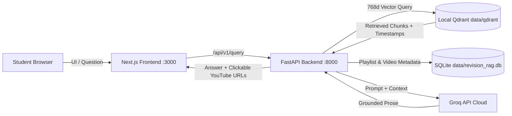

# Revision RAG

Revision RAG is an open-source revision knowledge base that turns YouTube playlists into searchable revision assistants with grounded answers and clickable timestamp citations.

This version features a **zero-hosting-cost, local-first distribution architecture**:
- **Pre-Indexed Knowledge Base**: Distributed with 7,000 vectors across **Strivers A2Z-DSA Course** and **Generative AI using LangChain**.
- **Embedded Local Qdrant**: Operates embedded on disk at `data/qdrant` without Docker, cloud vector accounts, or remote retrieval servers.
- **Compact Seed Database**: Seeded from `data/knowledge_base/student_revision_rag.db`.
- **Private BYO-Key LLM Generation**: Uses your own free Groq API key (`openai/gpt-oss-120b`) for ultra-fast grounded answer generation.

---

## Quickstart (Beginner-Friendly Setup)

### Linux & macOS (One-Command Setup)

```bash
# 1. Clone the repository
git clone https://github.com/your-username/revision-rag.git
cd revision-rag

# 2. Run automated installer
./install.sh

# 3. Launch application
./start.sh
```

### Windows (PowerShell)

```powershell
# 1. Clone the repository
git clone https://github.com/your-username/revision-rag.git
cd revision-rag

# 2. Run automated installer
.\install.ps1

# 3. Launch application
.\start.ps1
```

During installation, you will be prompted for your free **Groq API key** (get one at [console.groq.com/keys](https://console.groq.com/keys)). The installer automatically configures `.env`, builds the virtual environment, verifies the 7,000 pre-indexed vector chunks, and initializes the local database.

Once started, open your web browser at:
👉 **[http://localhost:3000](http://localhost:3000)**

---

### Manual / Advanced Setup

If you prefer manual control with `uv`:

```bash
# Install dependencies
uv sync
npm --prefix frontend install

# Configure environment
cp .env.example .env
# Edit .env and set your GROQ_API_KEY

# Launch unified runner
uv run python run.py
```

---

## Pre-Indexed Playlists

1. **Strivers A2Z-DSA Course | DSA Playlist | Placements**
   - **ID**: `3820e00b-81b6-4f34-9e68-011ddc3d9f98`
   - **Vectors**: 6,011 chunks (313 indexed videos from 315 discovered, metadata count 316)
   - **Topics**: Binary Search, Dynamic Programming, Graphs, Trees, Recursion, Arrays, Sorting.

2. **Generative AI using LangChain**
   - **ID**: `0fd210e4-904f-4127-b539-130cb1497377`
   - **Vectors**: 989 chunks (20 indexed videos)
   - **Topics**: Prompts, Models, Output Parsers, Memory, Chains, LCEL, Retrieval-Augmented Generation, Agents.

---

## Architecture Overview



---

## Application Modes

- **`APP_MODE=USER` (Default)**:
  - Connects to local persistent Qdrant at `data/qdrant/`.
  - Ingestion and video retry endpoints are disabled (HTTP 403) to protect the prebuilt knowledge base.
  - Requires only `GROQ_API_KEY`.
- **`APP_MODE=DEVELOPER`**:
  - Unlocks local discovery, audio downloading, Whisper speech-to-text fallback, and Qdrant ingestion.
  - Can connect to Qdrant Cloud or a local Qdrant server for new playlist ingestion.

### Adding Your Own Playlists (Developer Mode)

1. Open `.env` in any text editor and change:
   ```ini
   APP_MODE=DEVELOPER
   ```
2. Start the application:
   ```bash
   ./start.sh   # On Linux / macOS
   # or
   .\start.ps1  # On Windows
   ```
3. Open the Administration Panel in your browser:
   👉 **[http://localhost:3000/admin](http://localhost:3000/admin)**
4. Paste any public YouTube playlist URL and click **Submit Playlist**.
5. The automated ingestion worker will discover videos, extract transcripts (or transcribe audio with faster-whisper if captions are unavailable), translate into English if needed, generate 768-dimensional embeddings, and index the chunks into Qdrant.

---

## Repository Structure

```
├── run.py                          # Unified cross-platform runner
├── data/
│   ├── knowledge_base/             # Prebuilt distribution assets
│   │   ├── chunks_7000.jsonl.gz    # 7,000 vectors + payloads (29.9 MB gzip)
│   │   ├── manifest.json           # SHA-256 integrity manifest
│   │   └── student_revision_rag.db # Clean SQLite seed (11 MB)
│   ├── qdrant/                     # Local embedded vector database
│   └── revision_rag.db             # Local SQLite database
├── core/                           # lectra-core: vectorstore, retrieval, generation
├── backend/                        # lectra-backend: FastAPI REST API
├── frontend/                       # Next.js 16 App Router UI with Tailwind CSS
├── scripts/
│   ├── load_knowledge_base.py      # Qdrant local importer
│   ├── export_knowledge_base.py    # Qdrant export tool
│   └── create_student_database.py  # SQLite seed generator
└── docs/
    └── SETUP.md                    # Detailed onboarding guide
```

---

## Testing

Run the full test suite with:

```bash
uv run pytest tests/ backend/tests/ -v
```

---

## License

MIT License.
