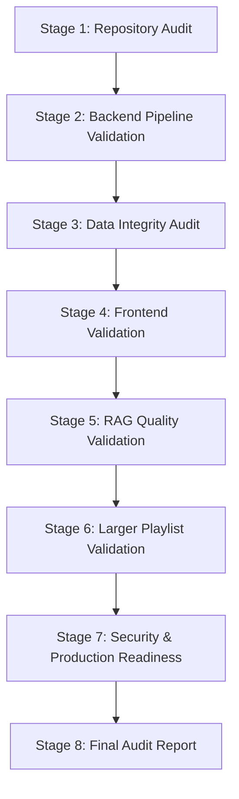

# Phase 9 — Lectra Final Validation and Product Readiness Plan

**Date**: 2026-11-01  
**Project**: Lectra — YouTube Revision RAG Engine  
**Status**: Stage 1 Repository & Architecture Audit Complete  

---

## 1. Executive Summary & Audit Scope

This document establishes the comprehensive test and validation plan for **Phase 9 (Final Validation and Product Readiness Audit)** of Lectra. The objective is to validate all system capabilities end-to-end without introducing architectural alterations, schema disruptions, or premature feature additions.

### Verified Architecture Baseline

| Subsystem | Component | Implementation / Technology | Status |
| :--- | :--- | :--- | :--- |
| **Backend API** | FastAPI 0.115+ | Modular v1 routers (`health`, `playlists`, `jobs`, `retrieval`, `answers`) | Verified |
| **Worker & Queue** | SQLite Jobs Table | Background stateful execution loop with retry & backoff | Verified |
| **Database** | SQLite + SQLAlchemy 2.0 | WAL mode, Alembic migrations (`c1f4e591789a` head) | Verified |
| **Metadata Discovery** | `yt-dlp` Provider | Flat playlist extraction, title/channel/duration normalization | Verified |
| **Transcript Pipeline**| `youtube-transcript-api` + Whisper fallback | Timestamp-preserving segment parsing & validation | Verified |
| **Translation** | M2M100 (HuggingFace) | English passthrough, multilingual translation to English | Verified |
| **Chunking** | Custom Semantic Token Chunker | Token-budgeted sliding window, deterministic UUID5 IDs | Verified |
| **Embedding** | EmbeddingGemma 2 | 768 dimensions, L2-normalized dense representations | Verified |
| **Vector Index** | Qdrant Cloud | Collection: `revision_chunks`, Cosine distance, deterministic point IDs | Verified |
| **Retrieval** | Dense Semantic Search | Cosine similarity thresholding, playlist/video metadata filters | Verified |
| **Answer Generation** | Groq API (`openai/gpt-oss-120b`) | JSON-grounded answers with citations, strict abstention | Verified |
| **Frontend UI** | Next.js 16 (Turbopack) + React 19 + TailwindCSS | Split-screen revision chatbot & ingestion dashboard | Verified |

---

## 2. Stage-by-Stage Validation Strategy

### Stage 1: Repository and Architecture Audit (Completed)
- **Codebase Integrity**: Python 3.12 workspace (`core/src/lectra_core`, `backend/src/lectra_backend`).
- **Frontend**: Next.js 16.4.3 client app with full TypeScript strictness.
- **Environment**: Centralized settings in `lectra_core.config.Settings`, `.env` isolation.
- **Test Infrastructure**:
  - `backend/tests/`: 21 tests (100% passing).
  - `core/tests/`: 148 tests (145 unit passing, 3 network-requiring integration tests).
  - `frontend/tests/`: 4 test suites (100% passing).

### Stage 2: Backend Pipeline Validation
We will validate each pipeline stage systematically:
1. **Playlist discovery**: Idempotent re-run behavior, title extraction, unavailable video detection.
2. **Video metadata persistence**: Video records, position, duration, status transitions.
3. **Transcript extraction**: Raw artifact storage, segment validation, start/end timestamps.
4. **English translation**: Verification of English passthrough and segment integrity.
5. **Transcript persistence**: Storage in SQLite `transcript_segments` and JSON artifacts.
6. **Chunk generation**: Token counts, segment coverage, deterministic UUID5 generation.
7. **Embedding generation**: 768-dimensional vector sanity check, non-NaN, non-zero norms.
8. **Qdrant indexing**: Idempotent point upsert, verification before state advancement.
9. **Semantic retrieval**: Top-k matching, score threshold adherence, scoped filtering.
10. **Grounded answer generation**: Groq client interaction, JSON parsing, prompt adherence.
11. **Citation synthesis**: Source mapping, timestamp link validation, abstention verification.

### Stage 3: Data Integrity Audit (SQLite ↔ Qdrant Consistency)
- Inspect `data/revision_rag.db` against Qdrant Cloud `revision_chunks`.
- Confirm 1-to-1 correspondence:
  - 56 database chunks ↔ 56 Qdrant points.
  - Dimension check: `dim == 768`.
  - Normalization: $\|v\|_2 \approx 1.0 \pm 10^{-4}$.
  - Payload verification: `video_id`, `playlist_id`, `chunk_index`, `start_seconds`, `end_seconds`, `text`.
- Output: `reports/phase9_data_integrity.json` + summary in final report.

### Stage 4: Frontend Validation
- **Data Ingestion Dashboard**:
  - Playlist submission, discovery display, 7-metric dashboard, progress bar, 6-stage video pipeline table, retry button, activity logs.
- **Revision Chatbot**:
  - Query dispatch, status badges (`answered`, `partially_answered`, `insufficient_context`), formatted citation badges, transcript excerpts.
- **Split-Screen YouTube Player**:
  - Auto-selection on new answers, manual citation selection, timestamp jumping, source card highlight synchronization, fallback links.

### Stage 5: RAG Quality Validation (Five-Video Greedy Regression)
Execute regression test cases covering:
1. Single-topic algorithmic conceptual query (Fractional Knapsack).
2. Code/complexity analysis query (Job Sequencing).
3. Boundary / multi-chunk query (N Meetings in One Room).
4. Partially supported query.
5. Unsupported query triggering strict abstention (`insufficient_context`).
Verify:
- No invented citations or video IDs.
- Verbatim transcript quotation in payloads.
- Correct YouTube timestamp construction.

### Stage 6: Larger Playlist Validation
- Identify candidate playlist (20–30 videos).
- Verify discovery, progress metrics, and chunk indexing.
- Verify retrieval and video playback remain performant and accurate.

### Stage 7: Security and Production Readiness
- Secret scanning (ensure `.env`, Groq keys, Qdrant keys never leak in Git or client bundles).
- API input validation and exception containment.
- CORS configuration validation.
- Tooling checks: `ruff check`, `mypy`, `npm run build`, `npm test`.

### Stage 8: Final Audit Report
- Deliver `reports/phase9_final_validation.md` with explicit PASS/FAIL/WARNING classifications.

---

## 3. Execution Schedule & Gate Criteria

| Stage | Gate Criteria | Action on Failure |
| :--- | :--- | :--- |
| **Stage 2** | All 11 processing stages verified with zero data corruption | Fix defect, verify idempotency |
| **Stage 3** | 100% agreement between SQLite chunks and Qdrant points | Log discrepancy, re-index missing points |
| **Stage 4** | Clean split-screen interaction, video player auto-select works | Fix frontend component |
| **Stage 5** | 0% hallucinations, 100% citation grounding precision | Check prompt/retrieval budget |
| **Stage 6** | Clean ingestion without crashes | Fix worker handling |
| **Stage 7** | Zero committed secrets, clean builds | Sanitize repo, fix build errors |
| **Stage 8** | Complete comprehensive audit report produced | Sign off product readiness |

